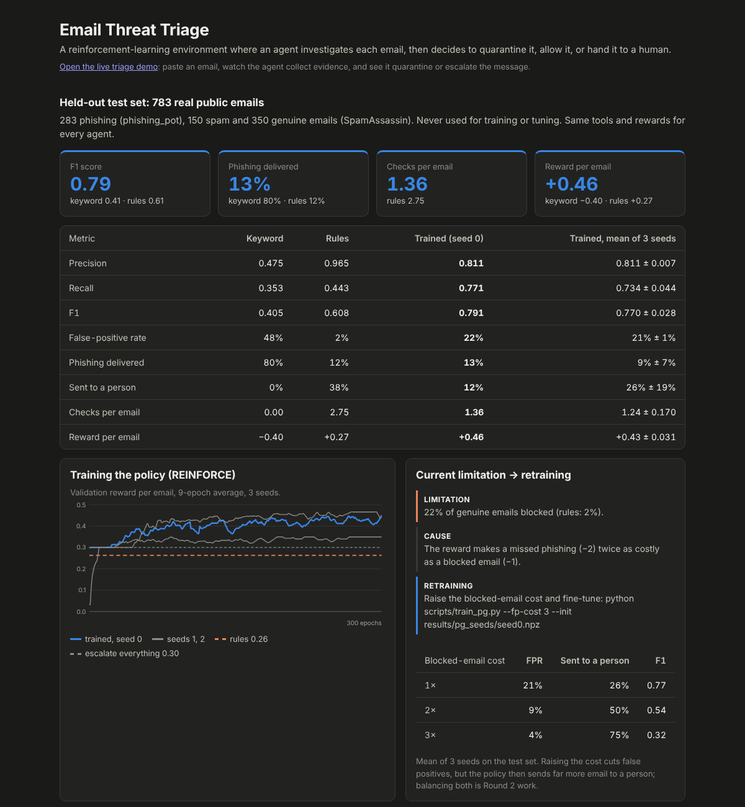
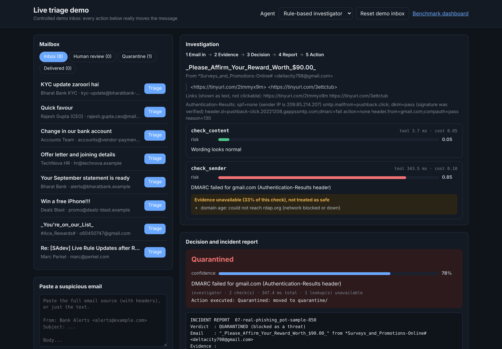

# Email RL Environment: Autonomous Email Threat Triage

A reinforcement-learning environment where an agent works through an inbox the way a
security analyst would. For each email it can **investigate** with tools (paying a small
cost per check), then it must **decide**: quarantine it, allow it, or escalate it to a human.

The project started in April 2026 as a spam / not-spam environment with a keyword agent.
That agent is still here as the baseline every newer agent is measured against.

## What is inside

- `EmailEnv`, a multi-step environment with `reset()` and `step()`, cost-aware rewards
- Three investigation tools backed by **real threat-intelligence lookups**: SPF/DKIM/DMARC,
  RDAP domain age, URL reputation (Google Safe Browsing, URLhaus, OpenPhish), short-link
  expansion. A failed lookup is reported as **evidence unavailable**, never as safe
- Four agents: keyword baseline, rule-based investigator, a **policy-gradient agent trained
  on the environment's rewards**, and an LLM tool-calling agent
- A **labelled public test set**: 1,566 emails (real phishing from phishing_pot, genuine and
  spam email from the SpamAssassin corpus), split 50/50 into train and held-out test
- Precision, recall, F1, false-positive rate and phishing miss rate for every agent
- A **live demo**: paste an email, watch the agent collect evidence, get a decision with
  confidence and an incident report, and see the email moved to quarantine or human review
  in a controlled demo inbox
- A standard **Gymnasium** interface (`env/gym_env.py`), checked with Gymnasium's env checker
- FastAPI server, dashboard, command-line runner, Docker for HuggingFace Spaces, 57 tests



## How it works

| Action | Type | Reward |
| --- | --- | --- |
| `check_content` | investigate | -0.05 |
| `check_sender` | investigate | -0.10 |
| `check_url` | investigate | -0.15 |
| `quarantine` / `allow` / `escalate` | decide | see below |

| True label | quarantine | allow | escalate |
| --- | --- | --- | --- |
| phishing | +1.0 | -2.0 | +0.3 |
| spam | +1.0 | -0.5 | +0.3 |
| legit | -1.0 | +1.0 | +0.3 |

After 4 steps without a decision the email is escalated with an extra -0.5. The
observation is the email (sender, subject, text, links, attachment names) plus the evidence
collected so far. The true label is never part of it.

### The RL problem

| | |
| --- | --- |
| Episode | one email (in `EmailEnv`, one pass over an inbox; in the Gymnasium wrapper, one email) |
| State | the email's visible fields + the evidence collected so far (risk, findings, unavailable lookups, coverage per check) + steps left. Never the label |
| Actions | 6, discrete: 3 checks, 3 decisions |
| Reward | check costs (-0.05 / -0.10 / -0.15) and the decision table above; both the false-positive cost and the escalation reward are constructor arguments |
| Transition | a check adds one evidence item; a decision ends the email; 4 checks without a decision force an escalation |
| What has to be learned | which checks are worth paying for on this email, and when the evidence is enough to act |

### Gymnasium

```python
from env.gym_env import EmailTriageEnv

env = EmailTriageEnv(split="train")            # 783 public emails; or emails=[...]
obs, info = env.reset(seed=0)                  # obs: float32 vector in [0, 1]
obs, reward, terminated, truncated, info = env.step(env.action_space.sample())
info["action_mask"]                            # for algorithms that support masking
```

`tests/test_gym.py` runs `gymnasium.utils.env_checker.check_env` on it.

## Threat intelligence (env/intel.py)

| Evidence | Source | When it fails |
| --- | --- | --- |
| SPF / DKIM / DMARC | the receiving server's top-most `Authentication-Results` header (set `TRUSTED_AUTHSERV_ID` to accept only your own server's); without it, live checks with dkimpy, pyspf and a DMARC DNS lookup | `unavailable`. A DNS canary (`_dmarc.google.com`) runs first, so a resolver that answers NXDOMAIN for everything cannot fake "no record" |
| Domain age | RDAP via rdap.org, measured at the email's `Date`, not today | `unavailable`, also when the domain was re-registered after the email was sent |
| Free-tenant senders | onmicrosoft.com, run.app, firebaseapp.com and ~40 other platforms | age is "not applicable"; hosting there is itself a signal |
| URL reputation | OpenPhish feed (no key), Google Safe Browsing (`GOOGLE_SAFE_BROWSING_KEY`), URLhaus (`URLHAUS_AUTH_KEY`) | `unavailable` when no source answers. "Not listed" is weak evidence, not proof of safety |
| Short links | one HTTP HEAD, redirect not followed | the link is flagged as hiding its destination |
| Local analysis | look-alike brand domains (real brand list in `data/brands.json`), punycode, raw IPs, machine-generated domains, reply-to and display-name tricks, risky attachments, English, Hinglish and 5 other languages' scam wording | always available |

Every evidence item carries `unavailable` (what could not be checked, and why) and
`coverage` (share of planned checks that answered). An unverified clean result scores
higher risk than a verified one, the investigator escalates instead of allowing when a
signal is already raised and lookups failed, and the incident report lists every gap under
"Not verified (lookups unavailable, NOT treated as safe)".

Modes (`INTEL_MODE`): `live` calls the services and caches answers in
`data/intel_cache.json`; `cache` replays only the cache (reproducible evaluation); `off`
reports every external lookup as unavailable (tests).

## Results on the held-out test set

`python scripts/evaluate.py`: 783 emails (283 phishing, 150 spam, 350 genuine), same tools and
reward for every agent, authentication headers stripped (see "Fairness" below), intel lookups
unavailable (this run was made where only local analysis works; see Limitations).

| Agent | Precision | Recall | F1 | FPR | Phishing miss | Escalated | Checks / email | Avg reward |
|---|---|---|---|---|---|---|---|---|
| Keyword baseline | 0.475 | 0.353 | 0.405 | 0.483 | 0.795 | 0.000 | 0.00 | -0.399 |
| Rule-based investigator | 0.965 | 0.443 | 0.608 | 0.020 | 0.124 | 0.382 | 2.75 | 0.268 |
| Policy gradient (shipped, seed 0) | 0.811 | 0.771 | 0.791 | 0.223 | 0.127 | 0.120 | 1.36 | 0.460 |
| Policy gradient, mean of 3 seeds | 0.811 ± 0.007 | 0.734 ± 0.044 | 0.770 ± 0.028 | 0.212 ± 0.008 | 0.091 ± 0.065 | 0.261 ± 0.194 | 1.24 ± 0.17 | 0.434 ± 0.031 |

Threat = phishing or spam. Precision, recall, F1 and FPR count automatic decisions only (an
escalated email is neither a true nor a false positive). Phishing miss rate = phishing that
was delivered; escalated phishing goes to an analyst.

What this shows:

- The **trained policy earns the most reward** (+0.46 vs +0.27 per email) with half the checks
  (1.4 vs 2.75). It learned to quarantine more and escalate less.
- It pays for that with a **22% false-positive rate** against 2% for the rule policy. That is the
  reward function talking: a missed phishing costs -2, a blocked genuine email only -1. Raising the
  false-positive cost is a one-line change in `email_env.py` and the policy will follow it.
- One of three seeds converged to a more cautious policy (54% escalated), hence the spread.
- The investigator's thresholds were tuned on the train split only; the policy was trained on
  80% of it and checkpointed on the other 20%. The test split was used once, for this table.

**Current limitation → retraining.** `EmailEnv(false_positive_cost=..., escalate_reward=...)`
and `scripts/train_pg.py --fp-cost C --init results/pg_seeds/seedN.npz` fine-tune the policy
under a higher cost for blocking genuine email (from scratch, every seed collapsed to "always
escalate"). `python scripts/fp_sweep.py`, test set, mean of 3 seeds:

| Blocked-email cost | False-positive rate | Sent to a person | F1 |
|---|---|---|---|
| 1× (shipped) | 21% | 26% | 0.77 |
| 2× | 9% | 50% | 0.54 |
| 3× | 4% | 75% | 0.32 |

The cost knob works, but the policy buys its lower false-positive rate by escalating much more.
Charging for analyst time as well (`--fp-cost 2 --escalate-reward 0`) stops the escalating but brings the
false-positive rate back to about 24%: with only in-email evidence the classes overlap. Live
lookups (domain age, URL reputation) are the next lever, then retraining. Seeds vary a lot at
higher costs; all runs are in `results/fp_sweep.json`.

**Real phishing vs authentication** (283 test phishing emails, headers kept): DMARC failed for
only 19 (7%); 99 (35%) passed DMARC, 133 (47%) had no DMARC policy at all. SPF failed or
soft-failed for 77 (27%). Authentication results help, but "passed SPF/DKIM/DMARC" does not
mean safe.

**Fairness.** The genuine emails are from 2002 and never carry authentication headers; the
phishing emails are from 2022-2026 and almost always do. Leaving the headers in would let an
agent learn "has the header" instead of "failed the check", so the comparison strips them from
every email. Redaction artefacts that give the label away (`phishing@pot`, SpamAssassin's
`taint.org` rewrites) are also scrubbed.

The 34 hand-written demo emails (`python scripts/evaluate.py --split demo`) are kept as an
India-specific scenario set; the investigator scores F1 0.75 there with 1 false positive.

## LLM agent

`agent/llm_agent.py` lets a model choose each action through tool calling (OpenAI-compatible
API, HuggingFace router by default). Every call records latency, tokens, the action and any
failure; failed calls fall back to the rule policy and are counted.

```bash
export HF_TOKEN=hf_...
python scripts/run_llm_eval.py --n 60          # stratified sample of the test set
python scripts/run_llm_eval.py --split demo    # the 34 scenarios
```

It prints API calls, failures by type, p50/p95 latency, tool choices, how many emails the model
decided without any fallback, and the same metrics as above next to the investigator and the
policy-gradient agent on the same emails, then saves `results/llm_run_<model>_<time>.json`.
No LLM results are reported in this README until such a run has been made.

## Live demo

```bash
uvicorn app:app --port 7860      # then open http://localhost:7860/demo
```



Pick a message in the demo inbox (or paste any raw email) and press Triage. The page shows each
check the agent paid for (risk, findings, unavailable evidence, latency), the decision with a
confidence score, the incident report, and the action it executed: the message is moved to
`quarantine/`, `review/` (human queue) or `delivered/` under `data/demo_inbox/live/`, and every
move is written to `actions.jsonl`. An analyst can release or quarantine what is in review.

The demo inbox has six hand-written scenarios plus two real phishing emails and one genuine
email from the public corpora (`scripts/make_demo_inbox.py`). To use a real mailbox, replace
`server/mailbox.py` with IMAP `UID MOVE` or the Gmail / Microsoft Graph APIs; the agent side
does not change.

## Run it

```bash
pip install -r requirements.txt

python inference.py --compare            # every agent on the demo scenarios
python inference.py --agent pg           # trained policy, step-by-step log
python scripts/evaluate.py               # held-out test set table (results/eval_test.json)
python scripts/train_pg.py --seed 0      # retrain the policy (about a minute on a laptop)
python scripts/fp_sweep.py               # false-positive cost sweep table (results/fp_sweep.json)
INTEL_MODE=live python scripts/evaluate.py   # with real lookups; fills data/intel_cache.json
uvicorn app:app --port 7860              # dashboard at / and live demo at /demo
python -m pytest
```

Rebuild the public dataset (needs the two corpora on disk):

```bash
git clone https://github.com/rf-peixoto/phishing_pot
npm pack @stdlib/datasets-spam-assassin && tar xzf stdlib-datasets-spam-assassin-*.tgz
python scripts/build_public_dataset.py phishing_pot package/data
```

## API

| Method | Path | Purpose |
| --- | --- | --- |
| GET | `/` | Benchmark dashboard |
| GET | `/demo` | Live triage demo |
| POST | `/reset`, `/step` | Drive the environment yourself |
| GET | `/run?agent=pg`, `/compare` | Run agents over the demo scenarios |
| GET | `/api/mailbox` | Demo inbox folders and audit log |
| POST | `/api/triage` | `{"file": "01-E15.eml"}` or `{"raw": "<email>"}`, optional `"agent"` |
| POST | `/api/review` | `{"file": "...", "verdict": "release" or "quarantine"}` |
| POST | `/api/mailbox/reset` | Restore the demo inbox |

## Environment variables

Copy `.env.example` to `.env`. Never commit `.env`.

| Variable | Needed for | Default |
| --- | --- | --- |
| `INTEL_MODE` | `live`, `cache` or `off` | `live` |
| `GOOGLE_SAFE_BROWSING_KEY`, `URLHAUS_AUTH_KEY` | extra URL reputation sources | none |
| `TRUSTED_AUTHSERV_ID` | only trust your own server's Authentication-Results | first header |
| `HF_TOKEN`, `API_BASE_URL`, `MODEL_NAME` | LLM agent | HF router, Llama 3.3 70B |
| `EMAIL_SOURCE`, `SUPABASE_URL`, `SUPABASE_KEY` | Supabase data source | `local` |
| `DEMO_INBOX_DIR` | where the demo inbox lives | `data/demo_inbox/live` |

## Project structure

```
email_rl_env/
├── email_env.py            # environment: actions, rewards, episode logic
├── baseline_agent.py       # original keyword agent
├── inference.py            # command-line runner
├── agent/
│   ├── policy.py           # rule-based investigator (thresholds tuned on train)
│   ├── pg_agent.py         # policy-gradient agent (numpy MLP, action masking)
│   ├── pg_policy.npz       # trained weights
│   ├── llm_agent.py        # LLM tool-calling agent, instrumented
│   ├── triage.py           # one email end to end (used by the demo)
│   ├── confidence.py       # decision confidence
│   └── report.py           # incident report
├── env/
│   ├── gym_env.py          # Gymnasium wrapper
│   ├── tools.py            # check_content, check_sender, check_url
│   ├── intel.py            # RDAP, URL reputation, SPF/DKIM/DMARC, cache
│   ├── eml.py              # raw email parser
│   └── state_processor.py
├── evaluator/              # grader (P/R/F1/FPR/miss rate) and dataset loading
├── scripts/                # build dataset, train, evaluate, LLM run, demo inbox
├── server/                 # FastAPI, dashboard, live demo page, demo mailbox
├── data/
│   ├── public/             # train.json, test.json (labelled public set)
│   ├── fallback.json       # 34 hand-written scenarios
│   ├── brands.json         # official domains of commonly imitated brands
│   └── demo_inbox/seed/    # controlled demo inbox
├── results/                # evaluation and training outputs
└── tests/
```

## Limitations

- **The reported test numbers were produced without network access**, so domain age, URL
  reputation and live DNS checks were all "unavailable" and only local analysis ran. The code
  for those lookups is tested against recorded responses. Running with `INTEL_MODE=live` on a
  connected machine fills `data/intel_cache.json`; old phishing domains may have expired or
  been re-registered since, which the age check reports as unavailable.
- **Era mismatch.** Genuine and spam emails are from 2002, phishing from 2022-2026. Stripping
  authentication headers removes the most obvious shortcut, but writing style and topics still
  differ between the two eras.
- **The confidence score is a heuristic** (evidence strength x coverage), not a calibrated
  probability.
- **No LLM results yet**: the harness is ready and needs an API key to run.
- phishing_pot is CC BY-NC 4.0 (non-commercial use, attribution); SpamAssassin data is
  public domain / CC0 via the stdlib-js package.

## Future work

- Run the LLM agent on the full test set and compare it with the trained policy
- Balance the false-positive cost against analyst time with live lookups switched on, and retrain
- Modern genuine email with real authentication headers, so SPF/DKIM/DMARC can be measured
  against both classes
- Connect a real mailbox over IMAP or Microsoft Graph
- Feedback from the analyst on escalated emails as an extra reward signal
